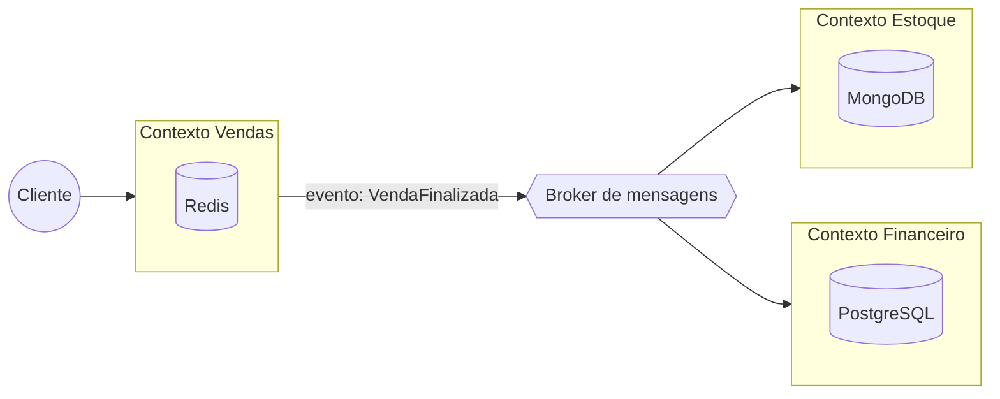
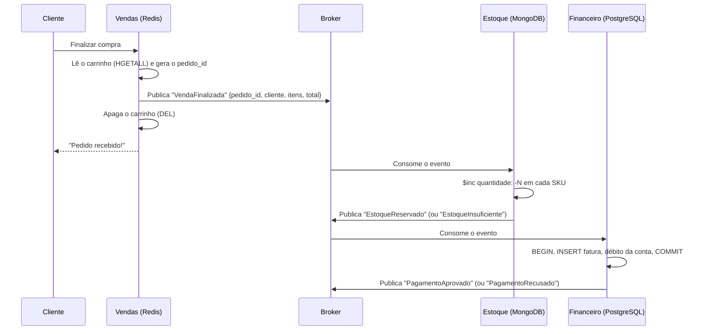

# ERP com Persistência Poliglota

Arquitetura de dados de um ERP dividida em **3 contextos delimitados** (Domain-Driven Design): **Vendas**, **Estoque** e **Financeiro**. Cada contexto usa o SGBD mais adequado ao seu padrão de acesso e à consistência de que precisa.

```
erp-persistencia-poliglota/
├── financeiro/
│   ├── faturas.sql            # PostgreSQL: tabela faturas + SUM do total faturado
│   └── bonus_transacao.sql    # PostgreSQL: transação que falha sem saldo (ROLLBACK)
├── estoque/
│   └── produtos.js            # MongoDB: coleção produtos com esquema flexível
├── vendas/
│   └── carrinho.redis         # Redis: sessão e carrinho com TTL
└── .github/workflows/
    └── validar-scripts.yml    # roda os scripts nos 3 bancos a cada push
```

---

## Parte 1: Arquitetura e contextos



### Limites de cada contexto

| Contexto | Responsabilidade | Fica de fora (pertence a outro contexto) |
|---|---|---|
| **Vendas** | Sessão do cliente, carrinho e checkout (fechar o pedido). | Quantidade em estoque e cobrança. |
| **Estoque** | Catálogo de produtos, especificações e saldo de unidades. | Preço cobrado no pedido e pagamentos. |
| **Financeiro** | Faturas, pagamentos, saldo de contas e transações. | Detalhes técnicos de produtos e carrinho. |

Os contextos **não compartilham banco**. Eles se referenciam só por identificadores (`pedido_id`, `sku`, `cliente_id`) e conversam por eventos (ver Parte 3).

### Escolha do SGBD e justificativa

#### Financeiro: PostgreSQL (relacional)
- **Precisa de transações ACID.** Um pagamento debita uma conta e credita outra: as duas operações acontecem juntas ou nenhuma acontece. Dinheiro não pode "sumir" nem ser duplicado.
- **As regras ficam no próprio banco** (`CHECK (saldo >= 0)`, `UNIQUE`, chaves estrangeiras). Mesmo com bug na aplicação, o banco recusa um dado inválido.
- **Os dados são estruturados e estáveis.** Uma fatura sempre tem cliente, valor, status e data, então o esquema rígido ajuda.
- **Relatórios usam SQL** (`SUM`, `GROUP BY`, `JOIN`), o que é essencial para fechamento contábil e auditoria.
- **Teorema CAP:** prioriza **Consistência (CP)**. É melhor recusar uma operação do que gravar um saldo errado.

#### Estoque: MongoDB (documentos)
- **Esquema flexível.** Em uma loja de eletrônicos, um celular tem cerca de 20 atributos (tela, bateria, câmeras, 5G) e uma capinha tem 2 (cor, modelo). O modelo relacional exigiria tabelas extras, como EAV (entidade-atributo-valor), e vários JOINs. O documento guarda cada produto com os atributos que ele realmente tem.
- **Leitura rápida:** o produto inteiro, com especificações aninhadas e listas, vem em uma única consulta, sem JOIN.
- **Evolução simples:** uma categoria nova com atributos novos não exige `ALTER TABLE` nem migração.
- **Escala horizontal (sharding)** para catálogos grandes.

#### Vendas: Redis (chave-valor / cache em memória)
- **Latência muito baixa:** os dados ficam em memória e as operações levam menos de 1 ms. O carrinho é lido e alterado a cada clique do cliente.
- **TTL nativo:** sessão e carrinho abandonado expiram sozinhos (`EXPIRE`), sem job de limpeza.
- **Operações atômicas** como `HINCRBY` aguentam muitos acessos simultâneos (Black Friday).
- **Dado temporário:** perder um carrinho abandonado é tolerável. Quando o pedido fecha, ele vira um registro permanente nos outros contextos.
- **Teorema CAP:** prioriza **Disponibilidade e Performance (AP)**.

### Entidades principais

| Contexto | Entidade | Atributos principais |
|---|---|---|
| Vendas | `Sessao` | id, usuario_id, nome, criada_em (TTL 30 min) |
| Vendas | `Carrinho` | id da sessão, itens `{sku -> quantidade}` (TTL 30 min) |
| Vendas | `Pedido` | pedido_id, cliente_id, itens, valor_total, status |
| Estoque | `Produto` | sku, nome, categoria, preco, quantidade, especificacoes `{...}` |
| Estoque | `MovimentacaoEstoque` | sku, tipo (entrada/saída), quantidade, pedido_id, data |
| Financeiro | `Fatura` | id, cliente, pedido_id, valor, status, emitida_em |
| Financeiro | `Conta` | id, cliente, saldo (`>= 0`) |
| Financeiro | `Transacao` | id, conta_origem, conta_destino, valor, data |

---

## Parte 2: Mini projeto (scripts)

| Contexto | Arquivo | O que faz |
|---|---|---|
| Financeiro | [`financeiro/faturas.sql`](financeiro/faturas.sql) | Cria a tabela `faturas`, insere 2 registros em transação e calcula o `SUM` do valor faturado (**2589.80**). |
| Estoque | [`estoque/produtos.js`](estoque/produtos.js) | Cria a coleção `produtos` com um **celular** (tela, bateria, câmeras, conectividade) e uma **camiseta** (tamanho, cor, material) e consulta campos que só um deles tem. |
| Vendas | [`vendas/carrinho.redis`](vendas/carrinho.redis) | Grava sessão e carrinho como Hash com TTL de 30 min, recupera, incrementa, remove item e renova o TTL. |

### Como executar

```bash
# Financeiro (PostgreSQL)
psql -U postgres -f financeiro/faturas.sql
psql -U postgres -f financeiro/bonus_transacao.sql

# Estoque (MongoDB)
mongosh estoque/produtos.js

# Vendas (Redis)
redis-cli < vendas/carrinho.redis
```

Com Docker, sem instalar nada:

```bash
docker run -d --name pg    -e POSTGRES_PASSWORD=postgres -p 5432:5432 postgres:16
docker run -d --name mongo -p 27017:27017 mongo:7
docker run -d --name redis -p 6379:6379 redis:7

docker exec -i pg    psql -U postgres < financeiro/faturas.sql
docker exec -i mongo mongosh --quiet   < estoque/produtos.js
docker exec -i redis redis-cli         < vendas/carrinho.redis
```

### Validação automática (CI)

O workflow [`.github/workflows/validar-scripts.yml`](.github/workflows/validar-scripts.yml) sobe **PostgreSQL, MongoDB e Redis** no GitHub Actions a cada push. Ele roda todos os scripts e confere os resultados:
- o total faturado é `2589.80`;
- a coleção `produtos` tem 2 documentos com esquemas diferentes;
- o carrinho existe com TTL ativo;
- no bônus, os saldos continuam `300.00 / 300.00` depois da transferência recusada.

---

## Parte 3: Desafio

### Integração assíncrona entre os contextos

Os três bancos **não se acessam diretamente**. A comunicação é feita por **eventos** publicados em um broker de mensagens (por exemplo RabbitMQ, Kafka ou o próprio Redis Streams). Fluxo de uma venda finalizada:



1. **Vendas (Redis):** quando o cliente clica em "Finalizar", o serviço de Vendas lê o carrinho, monta o pedido e **publica o evento `VendaFinalizada`** com `pedido_id`, cliente, itens (`sku`, quantidade) e valor total. O cliente recebe a resposta na hora, sem esperar os outros bancos.
2. **Estoque (MongoDB):** um consumidor escuta `VendaFinalizada` e dá baixa em cada produto com `updateOne({sku, quantidade: {$gte: N}}, {$inc: {quantidade: -N}})`. O filtro impede estoque negativo. Depois publica `EstoqueReservado`.
3. **Financeiro (PostgreSQL):** escuta o evento e, **dentro de uma transação ACID**, cria a fatura e registra o pagamento. Se faltar saldo, faz `ROLLBACK` (ver bônus) e publica `PagamentoRecusado`.
4. **Compensação (padrão Saga):** como não existe transação única entre três bancos diferentes, cada falha dispara uma ação que desfaz o passo anterior. Por exemplo, em `PagamentoRecusado` o Estoque devolve as unidades (`$inc: +N`) e Vendas marca o pedido como cancelado.
5. **Consistência eventual:** por alguns milissegundos o estoque pode estar atualizado e a fatura ainda não. Os sistemas convergem logo em seguida. Esse é o preço de cada contexto ser independente, escalável e resiliente: se o Financeiro cair, as vendas continuam e os eventos ficam na fila até ele voltar.
6. **Idempotência:** como um evento pode ser entregue mais de uma vez, cada consumidor usa o `pedido_id` para não processar o mesmo evento duas vezes. No Financeiro, a coluna `pedido_id UNIQUE` da tabela `faturas` impede fatura duplicada.

### Bônus: transação que falha sem saldo

Arquivo: [`financeiro/bonus_transacao.sql`](financeiro/bonus_transacao.sql)

- A tabela `contas` tem `CHECK (saldo >= 0)`.
- **Caso 1:** Ana transfere 200 para Bruno com `BEGIN … COMMIT`, e a transferência é concluída.
- **Caso 2:** Bruno (saldo 300) tenta transferir 1000. O `UPDATE` viola o `CHECK`, o PostgreSQL aborta a transação e o `ROLLBACK` desfaz tudo. O crédito para Ana nunca acontece.
- **Caso 3:** a mesma regra em PL/pgSQL. O bloco confere o saldo com `SELECT … FOR UPDATE` e lança `RAISE EXCEPTION 'Saldo insuficiente'`, e a exceção desfaz o bloco inteiro.
- No final, os saldos continuam **Ana = 300.00 e Bruno = 300.00**.

---

## Parte 4: Reflexão

### O que é Polyglot Persistence e por que grandes sistemas não usam um único banco?

**Persistência poliglota** é usar **vários tipos de banco de dados no mesmo sistema**, escolhendo para cada parte o banco que melhor resolve o problema daquela parte. A ideia é a mesma de usar a linguagem certa para cada tarefa: "o banco certo para o problema certo".

Grandes sistemas, como ERPs e e-commerces, não usam um único banco porque **cada tipo de dado tem um padrão de acesso e uma necessidade de consistência diferente**:

- **Dinheiro (Financeiro)** precisa de consistência absoluta e transações ACID. Um erro aqui gera prejuízo e problema legal. O banco relacional é o mais indicado.
- **Catálogo de produtos (Estoque)** tem estrutura muito variada e é muito mais lido do que escrito. Forçar tudo em tabelas fixas gera dezenas de colunas nulas ou JOINs complexos. O banco de documentos modela isso naturalmente.
- **Sessão e carrinho (Vendas)** são dados temporários, acessados a cada clique e que precisam expirar. Gravar isso em disco num banco relacional seria lento e encheria o banco de lixo. O cache em memória com TTL resolve com latência abaixo de 1 ms.

Se tudo ficasse em um único banco, haveria duas saídas ruins:
1. **Usar só o relacional:** o catálogo vira um emaranhado de tabelas e JOINs, e o carrinho sobrecarrega o banco principal com milhões de escritas temporárias, o que gera **gargalo de performance**.
2. **Usar só um NoSQL:** o Financeiro perde as garantias ACID e a integridade, o que gera **risco de inconsistência** em dados críticos.

Usar o banco certo para cada contexto **evita gargalos de performance**, **simplifica a modelagem** (cada dado fica no formato natural dele) e permite que **cada contexto escale de forma independente**. Também isola falhas: se o cache de Vendas cair, o Financeiro continua íntegro.

O preço é **mais complexidade operacional** (três tecnologias para manter, monitorar e fazer backup) e **consistência eventual** entre os contextos, que é tratada com eventos, Saga e idempotência (Parte 3). Por isso a persistência poliglota compensa em sistemas grandes e com domínios bem separados, mas pode ser exagero em uma aplicação pequena.
